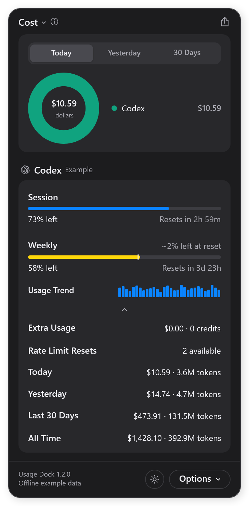
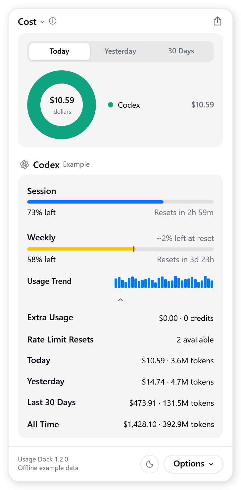
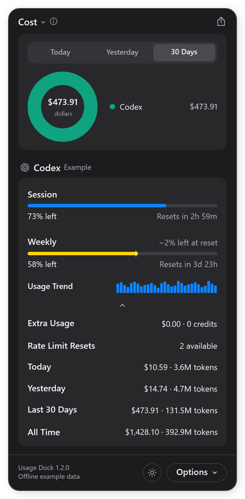

# Codex Usage Dock Tracker

A Windows 11 tray app for Codex subscription limits, local token history, and estimated API-equivalent cost. Click its white tray icon to open a compact dashboard with Today, Yesterday, 30 Days, and All Time totals.

**Use your own Codex sign-in.** Sign into Codex with your ChatGPT account first, then open Usage Dock. There is no shared account, bundled login, API key requirement, or separate developer billing setup. The release starts with no account data.

**Dollar figures are estimates, not charges.** Usage Dock applies bundled model prices to token counts recorded on your computer. It does not send prompts, run model generations, purchase credits, or redeem resets. This is an independent utility, not an official OpenAI application.

## Install

You need **Windows 11 x64** and Codex signed in with your own ChatGPT account. The release includes its .NET runtime, so Python, Node.js, an SDK, and administrator access are not required.

1. Open Codex and **sign in with ChatGPT using your own account**. Complete any password or verification prompts in the official sign-in flow. See [Codex authentication](https://learn.chatgpt.com/docs/auth).
2. [Download the latest Windows release](https://github.com/saintordevil/codex-usage-tracker/releases/latest). Choose **`UsageDock-Windows-x64.zip`**, not GitHub's source-code ZIP.
3. Right-click the ZIP, choose **Extract All**, and keep the complete folder in a permanent location. Do not run it from inside the ZIP.
4. Double-click **`UsageDock.exe`**. It detects your own default Codex home and reads your available usage. The first history scan can take longer than later refreshes.
5. If the tray icon is hidden, open the hidden-icons arrow beside the clock and drag the icon into the visible tray.

The defaults match the screenshots: **Dark theme, normal density, expanded metrics, and a five-minute refresh interval**. No startup entry is created just by running the app. The executable is unsigned; download it from this repository and compare the release's SHA-256 file if Windows asks you to assess its publisher.

### Preview without signing in

Double-click **`Preview Example.cmd`**. It opens the actual app with synthetic limits, tokens, and cost estimates. The footer says **Offline example data**. This mode makes no account requests and reads no Codex authentication or session files. Its display preferences are separate from normal usage.

### Start with Windows

After moving the release to its permanent folder, double-click **`Enable Windows Startup.cmd`**. It creates a shortcut in your current Windows user's Startup folder. The app starts quietly in the tray with `--background`; it does not install a service, scheduled task, or registry autorun.

Double-click **`Disable Windows Startup.cmd`** to remove that shortcut. If a shortcut already points to a different installation, open **Win+R**, enter **`shell:startup`**, and remove the old Usage Dock shortcut before enabling the new one.

### Upgrade

Choose **Quit** in the tray menu, replace the release files, then open `UsageDock.exe` again. Keep the same folder if Windows startup is enabled. Your settings and indexed history stay in `%LOCALAPPDATA%\UsageDock`, separate from the executable. Do not copy that personal data folder into a Git repository or shared ZIP.

## Use

| Control | Action |
|---|---|
| Tray icon | Open or hide the panel; right-click for Refresh, Settings, and Quit |
| Today / Yesterday / 30 Days | Change the top summary period |
| Cost selector | Switch between estimated cost, cost per million tokens, and tokens |
| Quota percentage | Toggle used and remaining allowance |
| Reset time | Toggle countdown and exact reset time |
| Spending value | Show the per-model breakdown |
| Theme button | Switch Dark and Light |
| Options | Customize rows, open Settings, copy a screenshot, export CSV, refresh, or quit |
| All Time | Show all available indexed usage, including retained history older than 30 days |

Customize lets you hide or reorder metrics and pin two values to the tray tooltip. **Esc** goes back or hides the panel, **Ctrl+R** refreshes, **Ctrl+,** opens Settings, and **Ctrl+Q** quits. A second normal launch opens the existing instance. A second background launch does not open another panel.

## Screenshots

These are rendered from the app's offline example mode. All account limits, token counts, dates, and cost totals shown are synthetic; no personal account or usage is pictured.

The 30-day view uses the same example history and bundled pricing calculation.

## Data and privacy

| Data | Handling |
|---|---|
| ChatGPT login | You sign into Codex yourself; Usage Dock does not collect a password |
| Codex authentication | Read in memory when available; sent only to the fixed ChatGPT usage endpoints |
| Account recovery | An installed Codex app-server may briefly read the signed-in account and its limits; Codex owns token refresh |
| Conversation files | Scanned locally for numeric usage records; conversation text is not exported or uploaded |
| Settings and latest readings | Stored under your own `%LOCALAPPDATA%\UsageDock` |
| Indexed token history | Retained locally in a per-Codex-home SQLite ledger |
| CSV and copied screenshots | Created only when you choose them; they contain your usage, so review before sharing |
| Example mode | Uses synthetic data and separate `%LOCALAPPDATA%\UsageDockDemo` preferences |

There is no telemetry, background browser, local web server, or upload to the developer. Direct requests are restricted to `https://chatgpt.com/backend-api/wham/usage` and the optional reset-credit details endpoint on the same host. Redirects are disabled. Tokens are not written into Usage Dock's caches or diagnostics. These are local files, not an encrypted vault; software running as your Windows user can access your local usage data.

## Accuracy and compatibility

- Live limits come from the signed-in account. Some plans provide only a weekly window; missing values are not displayed as zero.
- Costs use available local `.jsonl` and `.jsonl.zst` session history and a **12 October 2026 pricing snapshot**. They are estimated API-equivalent value, not your subscription bill or verified API spending. Future price changes require an update.
- All Time means all available, indexed usage. Deleted history never indexed, cloud-only sessions, separate tool charges, taxes, and unknown token details cannot be reconstructed.
- The reader preserves indexed totals after original logs disappear, deduplicates supported replay/fork records, and marks incomplete or unpriced data. Unknown models retain their tokens.
- Codex subscription reads use service interfaces that can change. API-key-only accounts do not supply the ChatGPT subscription limits this app displays. ARM64 Windows and other providers are not part of this release.

## Troubleshooting

| Symptom | Check |
|---|---|
| No subscription reading | Open Codex, sign into your own ChatGPT account, then choose Refresh. Never send anyone `auth.json`. |
| No Codex account reader found | Keep an official Codex desktop installation or npm-installed Codex CLI available. The app can read an existing file-backed sign-in directly; some credential-store setups need the installed account reader. |
| History is empty | Use Codex locally first. Check **Settings > Codex Home** if you use a custom `CODEX_HOME`. |
| Reading is outdated | The last successful value is retained during connection errors. Refresh retries with bounded backoff. |
| Totals differ from a bill | They are estimates from local token records and bundled prices, not billing records. |
| Startup points to an older folder | Remove its shortcut from `shell:startup`, then enable startup from the new permanent folder. |
| The screenshot says Example | Close the preview through its tray menu and open `UsageDock.exe` for your own account. |

## Build from source

Install the [Microsoft .NET 10 SDK](https://dotnet.microsoft.com/download/dotnet/10.0), clone or download the source, and run **`build.cmd`**. It runs the regression tests and creates a self-contained release in `release`. Set `USAGE_DOCK_DOTNET` to a particular `dotnet.exe` if needed. ZstdSharp.Port 0.8.8 is the pinned compressed-history dependency; Windows supplies SQLite through `winsqlite3.dll`.

The repository contains source, public model-price data, dependency notices, and synthetic screenshots only. Personal settings, authentication, caches, databases, logs, and build outputs are excluded from Git. See [UPSTREAM.md](UPSTREAM.md) for source provenance and the included dependency notices.

## License

[MIT](LICENSE)
